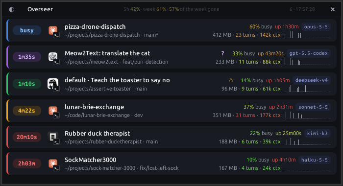
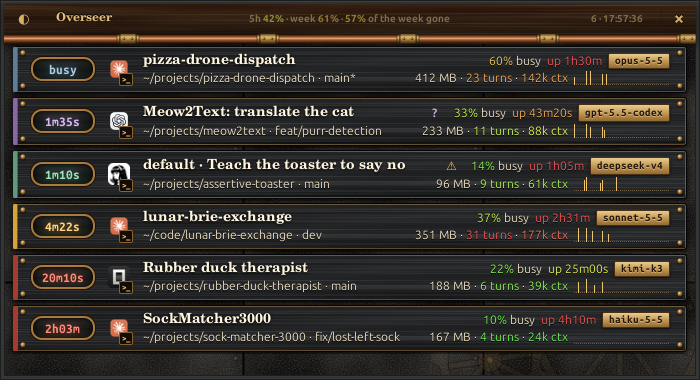
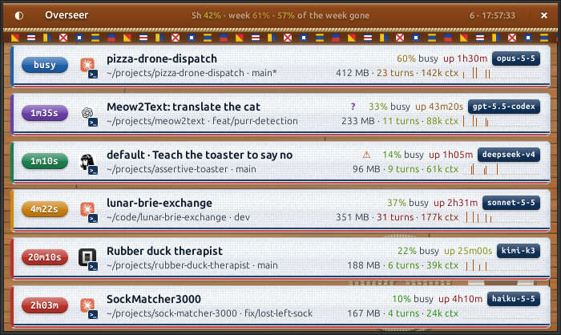

# Overseer

A small always-on-top window that lists your running AI coding sessions (Claude Code, Codex, OpenCode, Hermes), shows which one is working, which one waits for you, and which one is about to lose its prompt cache. Click a row to jump to its terminal or app window.



**Read-only.** Overseer only reads the files and processes the tools already leave on disk. It never writes to a session, sends no prompt, kills nothing and makes no network call. The only thing it changes is the focus: a click brings another window or tab to the front.

## Install

Linux only, with a desktop (GTK 3). Tested on Ubuntu with X11.

```bash
sudo apt install python3-gi gir1.2-gtk-3.0 xdotool x11-utils libglib2.0-bin xdg-utils libnotify-bin git
git clone https://github.com/AIverflow/overseer.git
cd overseer
python3 overseer.py
```

No pip package, no other dependency. Without one of the helper tools the board still runs: a click on a row says which package is missing.

Start it with your session (optional): create `~/.config/autostart/overseer.desktop`, with the real path of your clone:

```ini
[Desktop Entry]
Type=Application
Name=Overseer
Exec=python3 /path/to/overseer/overseer.py
X-GNOME-Autostart-enabled=true
```

## Use

```bash
python3 overseer.py           # the window
python3 overseer.py --list    # print the sessions once in the terminal, no window
python3 overseer.py --next    # focus the session to handle next, then exit
python3 overseer.py --help    # all options
```

An empty board (or an empty `--list`) means no session is running: start Claude Code, Codex, OpenCode or a Hermes CLI and its row appears within the refresh period. Servers and gateways (`hermes gateway`, `opencode serve`) are not sessions and are not listed.

### What a row shows

- Top line: session name, share of the last 30 min spent working, session age, model.
- Bottom line: folder and git branch, number of prompts, memory, context size, and a small timeline of the context over 30 min.

| Colour / sign | Meaning |
|---|---|
| grey | the agent is working |
| green → orange → red | idle since: under `--warn` (4 min), under `--limit` (5 min), beyond. Tracks the prompt cache window: past red, the next prompt pays the full context again |
| purple `?` | the agent waits for you (permission prompt, question). Click it to see what for |
| yellow `⚠` | an API error in the last 30 min. Click it to read it |

A desktop notification pops up when a session finishes or starts waiting for you (`--no-notify` turns it off).

### Mouse

- **Click a row**: the terminal tab, pane or app window of that session comes to the front. This changes the focused window, on purpose.
- **Right-click a row**: hide that session until its process ends, or pick a theme.
- **◐ button**: next theme. Themes: dark, light, terminal, crt, steampunk, cga, yacht.

| steampunk | yacht |
|---|---|
|  |  |

### Options

| Option | Default | Effect |
|---|---|---|
| `--warn N` | 240 | orange after N s idle |
| `--limit N` | 300 | red after N s idle |
| `--interval N` | 10 | refresh every N s |
| `--theme NAME` | last one picked | start with this theme |
| `--no-notify` | | no desktop notification |
| `--no-limits` | | hide the account limits bar |
| `--list` | | print once and exit |
| `--next` | | focus the session waiting for you, else the one closest to losing its cache. Bind it to a keyboard shortcut |
| `--focus PID` | | focus the terminal tab or app window of process PID and exit |

## Supported tools

| Tool | What is listed |
|---|---|
| Claude Code | CLI sessions, background sessions (shown in the console that displays them), the Code tab of the Claude desktop app |
| Codex | CLI sessions, the ChatGPT desktop app |
| OpenCode | TUI sessions |
| Hermes | CLI sessions (profile and title), the Hermes desktop app |

Config folders follow each tool's own variable when it is set in the environment that starts Overseer: `CLAUDE_CONFIG_DIR`, `CODEX_HOME`, `HERMES_HOME`, `XDG_DATA_HOME` (OpenCode). Otherwise the defaults (`~/.claude`, `~/.codex`, `~/.hermes`, `~/.local/share/opencode`).

## Limits: when it does not work

| Case | What happens |
|---|---|
| Not Linux | does not run (reads `/proc`) |
| Konsole, tmux, herdr | a click selects the right tab or pane and raises the window |
| Other terminals (GNOME Terminal, kitty, WezTerm…) | a click raises the terminal window, not the right tab |
| Desktop apps | a click raises the app window, and opens the session when the app has a link for it |
| Wayland | the tab or pane is selected, but the window is not raised; GNOME may ignore "always on top". Not tested: `GDK_BACKEND=x11 python3 overseer.py` may keep it on top |
| Sessions inside Docker or another container | ignored |
| "Waits for you" for Hermes and OpenCode | a guess from the last messages; can be wrong |
| Claude background session moved to another console | followed from internal Claude files that are not a stable format; after a Claude update the click may go to the old console |
| Tool updates | Overseer reads files the tools do not document. A new version of a tool can break a row until Overseer is updated |

## Account limits bar (optional)

The title bar can show the account limits: the 5 h window, the weekly window, and the share of the week already elapsed. Without the data, the bar is simply hidden; everything else works.

Overseer reads `~/.cache/overseer/limits.json`:

```json
{"updated": 1795100000.0, "rate_limits": {
  "five_hour": {"used_percentage": 37, "resets_at": 1795139400},
  "seven_day": {"used_percentage": 63, "resets_at": 1795345200}}}
```

Nothing writes that file by default. Each tool has to share its numbers.

### Claude Code

Claude Code only gives the limits to the status line script. Add this near the top of `~/.claude/statusline.sh`, right after the script reads stdin into `$input`:

```bash
if echo "$input" | jq -e '.rate_limits' >/dev/null 2>&1; then
  mkdir -p ~/.cache/overseer
  echo "$input" | jq -c '{updated: now, rate_limits: .rate_limits}' > ~/.cache/overseer/limits.json.tmp \
    && mv ~/.cache/overseer/limits.json.tmp ~/.cache/overseer/limits.json
fi
```

- Needs `jq`.
- Turn it off: delete those lines, or start the board with `--no-limits`.
- The file refreshes only while a Claude session redraws its status line. Percentages older than 10 min show "as of Xm ago". The elapsed share of the week comes from the clock and is always fresh.

### OpenAI / Codex

Not supported yet. Codex has no status line script to hook. It logs the limits in its session files (`~/.codex/sessions/YYYY/MM/DD/rollout-*.jsonl`, events `token_count`, field `payload.rate_limits`), but Overseer does not read them yet.

## License

MIT, see `LICENSE`.
